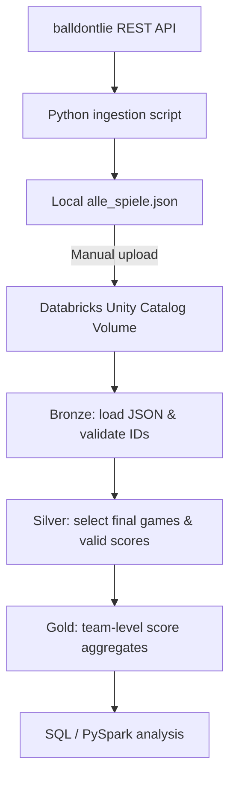

# NBA Data Engineering Pipeline

An independent learning project demonstrating data ingestion with Python and a three-layer data processing pipeline in Databricks using PySpark and Delta Lake.

## Project overview

NBA game records are retrieved from the [balldontlie API](https://www.balldontlie.io/) using Python and saved as a local JSON file. The JSON file is **manually uploaded** to a Databricks Unity Catalog Volume. Databricks notebooks then process the data through Bronze, Silver, and Gold layers and create aggregated team statistics.

> **Scope:** Portfolio / learning project, not a production system. The API ingestion runs locally; the transfer to Databricks is manual. The ingestion script defaults to a maximum of two API pages (up to 200 games). Actual results depend on the API response and subscription permissions.

## Architecture



## Technologies

- **Python:** `requests`, `python-dotenv`, JSON file handling, cursor-based pagination
- **Databricks / PySpark:** DataFrames, transformations, checks and managed tables
- **Delta Lake:** Data storage and separate experiments with Time Travel / RESTORE
- **SQL:** Delta version comparison and validation exercises
- **Unity Catalog Volumes:** Source JSON storage

## Repository structure

```text
nba-data-engineering-pipeline/
├── ingestion/
│   └── nba_api_ingestion.py
├── notebooks/
│   ├── NBA_01_Bronze.py
│   ├── NBA_02_Silver.py
│   ├── NBA_03_Gold.py
│   └── NBA_04_Delta_Time_Travel.py
├── .env.example
├── .gitignore
├── requirements.txt
└── README.md
```

## Pipeline stages

| Stage | What it does | Data quality checks |
| --- | --- | --- |
| Ingestion | Request paginated NBA game data and write a JSON array | Response type and empty result checks |
| Bronze | Load source JSON and write `nba.default.bronze_spiele` | Non-empty input, missing IDs, duplicate IDs, persisted row count |
| Silver | Filter completed (`Final`) games; extract team names and scores | Non-empty result, non-null team names, positive scores |
| Gold | Combine home and away results, aggregate games played and points per team | Non-empty output, non-null team names, nonzero game counts, two team appearances per Silver game, persisted row count |

The fourth notebook, `NBA_04_Delta_Time_Travel.py`, contains **separate learning exercises** for inspecting Delta history, comparing versions and restoring a test table. It is not an additional production stage in the scheduled pipeline. Historical version numbers in this notebook refer to the original workspace and may not exist in other workspaces.

## Run the API ingestion locally

1. Install Python and create a virtual environment if desired.
2. Install dependencies: `pip install -r requirements.txt`.
3. Copy `.env.example` to `.env` and add your own `NBA_API_KEY` value. Do **not** commit `.env`.
4. Run `python ingestion/nba_api_ingestion.py` from the repository root.
5. A local `alle_spiele.json` file will be created in the repository root. It is excluded via `.gitignore`.

The script's local test output was:

```text
Page 1: loaded 100 games
Page 2: loaded 100 games
Saved 200 NBA games to alle_spiele.json
```

This verifies the local API step ran successfully; it does not independently establish that the full Databricks pipeline was rerun with this exact file.

## Run the Databricks notebooks

1. Create or identify a Unity Catalog catalog/schema and a Volume for the JSON file.
2. Upload `alle_spiele.json` manually to the Volume.
3. Adjust `SOURCE_PATH` and table names at the top of the notebooks to your workspace. The current paths use `nba.default` and `/Volumes/nba/default/nba_data/alle_spiele.json`.
4. Import the `.py` files as Databricks notebooks or add them to your workspace.
5. Run `NBA_01_Bronze.py` → `NBA_02_Silver.py` → `NBA_03_Gold.py` in this order. The workflow was also orchestrated with Databricks Jobs in the original workspace; its job configuration is not included in this export.

**Prerequisites:** A Databricks workspace with an appropriate Spark environment and permissions to read the Volume and create/replace tables. The notebook code relies on the Databricks-provided `spark` session and is **not** directly executable as ordinary local Python.

## Learning outcomes and limitations

- Demonstrates REST API extraction, pagination, JSON, layered transformations and data validation.
- Demonstrates PySpark aggregations and Delta Lake inspection techniques.
- Silver currently drops the source game ID, which limits row-level lineage. Retaining the ID would be a useful next improvement.
- Bronze and Gold use `createOrReplace()` rather than incremental processing; reruns rebuild the corresponding tables.
- No automated end-to-end integration from the local API script into the Databricks Volume is included.
- The Delta Time Travel notebook is exploratory and expects versions and test tables that exist in the original workspace.

## Data source and security

NBA game records are sourced from the balldontlie API. An API key is required. Credentials and downloaded JSON data are intentionally not included. Please consult the provider's terms before redistributing API datasets.

## Author

[TimRabus](https://github.com/TimRabus) — personal Data Engineering learning portfolio.
