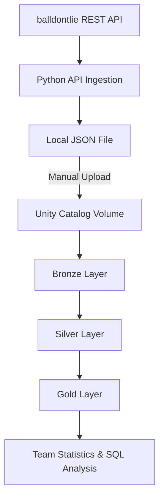
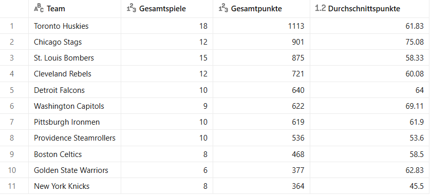
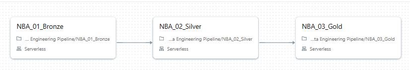
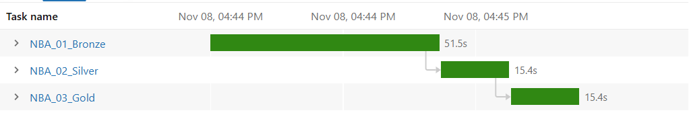

# NBA Data Engineering Pipeline

**Python | SQL | PySpark | Databricks | Delta Lake | Medallion Architecture**

An independent Data Engineering project demonstrating REST API ingestion, data transformation, quality validation and workflow orchestration using Python and Databricks.

The project implements a three-layer Medallion Architecture (Bronze, Silver and Gold) to process NBA game data and generate aggregated team statistics.

## 1. Project Overview

The objective of this project is to design and implement a structured data pipeline that transforms raw NBA game data into validated, analytics-ready datasets.

NBA game records are retrieved from the [balldontlie API](https://www.balldontlie.io/) using a Python script developed in Visual Studio Code.

The data is saved locally as JSON and manually uploaded to a Databricks Unity Catalog Volume. From there, PySpark notebooks process the data through Bronze, Silver and Gold layers.

The Databricks processing stages are orchestrated through Databricks Jobs using Serverless Compute.

**Project scope:** Independent learning and portfolio project, not a production deployment. API ingestion and Databricks processing are separate workflows connected through a manual file upload.

## 2. Data Pipeline Architecture



The architecture follows a layered approach to separate raw data ingestion, transformation and analytical aggregation.

## 3. Technologies & Tools

| Technology | Application |
|---|---|
| Python | REST API requests, pagination, JSON processing and error handling |
| SQL | Data validation, querying and Delta Lake version comparisons |
| PySpark | DataFrame transformations, filtering and aggregations |
| Databricks | Data processing, notebook execution and workflow orchestration |
| Delta Lake | Managed data storage, table history, Time Travel and RESTORE exercises |
| Unity Catalog | Structured data organization and Volume storage |
| Databricks Jobs | Sequential task execution and dependency management |
| GitHub | Version control and technical project documentation |

## 4. Repository Structure

```text
nba-data-engineering-pipeline/
│
├── ingestion/
│   └── nba_api_ingestion.py
│
├── notebooks/
│   ├── NBA_01_Bronze.py
│   ├── NBA_02_Silver.py
│   ├── NBA_03_Gold.py
│   └── NBA_04_Delta_Time_Travel.py
│
├── docs/
│   ├── gold_team_statistics.png
│   ├── databricks_workflow.png
│   └── databricks_job_run.png
│
├── .env.example
├── .gitignore
├── requirements.txt
└── README.md
```

## 5. Pipeline Implementation

### 5.1 Data Ingestion – Python REST API

The ingestion script retrieves NBA game data from the balldontlie REST API.

Implemented features:

- API authentication using environment variables
- HTTP requests using the Python `requests` library
- Cursor-based pagination
- HTTP error handling and request timeouts
- JSON response validation
- Local JSON file generation

The ingestion script currently requests a maximum of two API pages, with up to 100 records per page.

**Example execution output:**

```text
Page 1: loaded 100 games
Page 2: loaded 100 games
Saved 200 NBA games to alle_spiele.json
```

The output confirms that the local ingestion script successfully retrieved and saved 200 NBA game records during testing.

The resulting file is manually transferred to Databricks for further processing.

### 5.2 Bronze Layer – Raw Data Processing

**Notebook:** `NBA_01_Bronze.py`

The Bronze layer reads raw NBA game records from a Unity Catalog Volume and stores them as a Delta table.

Key operations:

- Load source data from JSON
- Validate that the dataset is not empty
- Identify missing game IDs
- Check for duplicate game IDs
- Persist data in a managed Delta table
- Verify the stored row count

**Output table:** `nba.default.bronze_spiele`

The Bronze layer establishes a structured foundation for subsequent transformations.

### 5.3 Silver Layer – Data Cleaning & Transformation

**Notebook:** `NBA_02_Silver.py`

The Silver layer transforms raw game records into a cleaner dataset suitable for further analytical processing.

Key operations:

- Filter games with a completed (`Final`) status
- Extract home and visitor team names
- Extract team scores
- Remove records with missing team names
- Filter records with invalid scores
- Validate that the resulting dataset contains records

The Silver layer focuses on improving data consistency and ensuring that only qualifying game records proceed to the Gold layer.

**Current limitation:** The source game ID is not retained in the Silver output. Preserving this identifier would improve record-level traceability and facilitate additional validation.

### 5.4 Gold Layer – Aggregated Team Statistics

**Notebook:** `NBA_03_Gold.py`

The Gold layer transforms completed NBA games into team-level statistics.

Home and visitor team results are combined and aggregated using PySpark.

Calculated metrics include:

- Games played per team
- Total points scored
- Average points scored per game

Additional validation checks verify:

- Non-empty output
- Non-null team names
- Positive game counts
- Consistency between completed games and team appearances
- Persisted row count

**Output table:** `nba.default.gold_teamstatistik`

### Example Gold Layer Output

The following screenshot shows aggregated team statistics generated in Databricks from a limited historical NBA game dataset.

The results demonstrate how individual game records are transformed into a structured analytical table. They do not represent a complete current NBA season.



## 6. Workflow Orchestration – Databricks Jobs

The Bronze, Silver and Gold notebooks are orchestrated using Databricks Jobs with Serverless Compute.

The workflow defines sequential execution dependencies:

1. **Bronze:** Load and validate raw JSON data.
2. **Silver:** Clean and transform completed game records.
3. **Gold:** Generate and validate aggregated team statistics.

Each subsequent task depends on the successful completion of the previous task.

### Databricks Workflow Architecture



### Successful Pipeline Execution



A documented workflow execution completed all three tasks successfully.

| Task | Execution Duration |
|---|---:|
| Bronze | 51.5 seconds |
| Silver | 15.4 seconds |
| Gold | 15.4 seconds |
| **Total task execution time** | **82.3 seconds** |

This demonstrates task dependency management and successful execution of the three processing stages.

The durations reflect one documented execution and do not represent a performance benchmark or guaranteed runtime.

The Databricks Job configuration is maintained in the original workspace and is not included as an exported deployment configuration in this repository.

## 7. Delta Lake – Time Travel & Version Management

**Notebook:** `NBA_04_Delta_Time_Travel.py`

A separate notebook contains practical exercises exploring Delta Lake version management.

Implemented exercises include:

- Inspecting Delta table history
- Querying historical table versions
- Comparing table versions using SQL
- Identifying differences between historical datasets
- Restoring a table to a previous version using `RESTORE`

These exercises demonstrate an understanding of Delta Lake's versioning and recovery capabilities.

They are separate from the scheduled Bronze–Silver–Gold processing workflow.

The notebook references historical versions and test tables from the original Databricks workspace. Those versions may not be available in another environment.

## 8. Data Quality & Validation

Data quality checks are implemented throughout the pipeline.

| Pipeline Stage | Validation |
|---|---|
| API Ingestion | Response validation and empty-result handling |
| Bronze | Missing game IDs, duplicate game IDs, non-empty data and stored row count |
| Silver | Completed games, valid team names, valid scores and non-empty output |
| Gold | Team-name completeness, positive game counts, game-to-team consistency and stored row count |

The objective is to identify potential data quality issues before they affect downstream analytical results.

## 9. How to Run the Project

### Step 1 – Set up the Python environment

Install Python and the dependencies listed in `requirements.txt`.

```bash
pip install -r requirements.txt
```

### Step 2 – Configure API authentication

Create a local `.env` file based on `.env.example`.

```text
NBA_API_KEY=your_api_key
